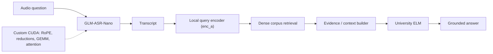

# Machine Learning Systems — CUDA ASR & RAG

**University of Edinburgh · INFR11269 · Autumn 2026**

An end-to-end machine learning systems coursework project that connects **custom CUDA kernels for automatic speech recognition** with **retrieval-augmented answer generation**. This repository contains the `MLS-Dwayne` branch: my independent implementation, experiments, and ongoing investigation within a shared team repository.

[ASR implementation](hw1-asr/) · [RAG pipeline](rag/) · [Coursework report resources](report/) · [Official course repository](https://github.com/ed-aisys/edin-mls-26-autumn)

> **Status — 4 November 2026:** All four CUDA tasks are implemented and validated (**33/33 standalone tests pass**). The reference RAG pipeline, practice/dev retrieval baselines, and initial end-to-end answer generation are working. The retrieval-depth/reranking systems investigation is **planned, not yet implemented**.

## The system



The ASR module uses our own CUDA implementations for the main GPU operations; the RAG module uses the recognised question to retrieve records from a **24,000-document corpus** and generate an answer using the University ELM service.

## Project progress

| Component | Status | What was validated |
|---|---|---|
| Task 1 — Rotary Position Embeddings | Complete | 4/4 tests; thread-block and precision experiments |
| Task 2 — GPU Reductions | Complete | 11/11 tests; RMSNorm, LayerNorm/softmax, barrier and atomic experiments |
| Task 3 — Tiled GEMM | Complete | 10/10 tests; shared-memory tiling, coalescing, padding and fused GELU |
| Task 4 — Streaming Attention | Complete | 8/8 tests; GQA, causal masking, online softmax and warp-count experiments |
| Full custom-CUDA ASR | Complete | 33/33 combined tests; supplied transcription matches reference |
| RAG setup and end-to-end reference pipeline | Complete | Assets/preflight, adapter tests, audio-to-answer smoke tests |
| Retrieval baselines | Complete | All 350 practice and 125 development queries evaluated |
| Retrieval-depth / cross-encoder investigation | In progress — design selected | Implementation and controlled comparisons pending |
| Final report and submission audit | Pending | To be completed after the systems investigation |

### ASR correctness and performance

Our CUDA implementation of **GLM-ASR-Nano** runs all four coursework kernels:

| Kernel | Main technique | Retained configuration |
|---|---|---|
| RoPE | Element-wise position-dependent Q/K rotations | 256 threads/block |
| Reductions | Warp shuffles, shared-memory block reductions, stable softmax | 256 threads/block |
| GEMM | Shared-memory tiled matrix multiply + bias/GELU fusion | TILE = 32 |
| Attention | Streaming K/V tiles with online softmax | 16 warps/block; padded K rows |

The clean RTX 2080 Ti (`sm_75`) build passed **33/33 tests**, and both all-PyTorch and all-custom-CUDA backends produced the expected coursework transcription.

| End-to-end ASR measurement | PyTorch backend | Custom CUDA backend |
|---|---:|---:|
| Inference latency, profiled run | 1,078.8 ± 0.9 ms | 2,719.3 ± 8.0 ms |
| Reported peak GPU memory | 8.88 GiB | 8.56 GiB |
| Supplied transcription check | PASS | PASS |

**Interpretation:** The custom pipeline is **2.52× slower overall**, mainly because the instructional tiled GEMM does not match NVIDIA's tuned cuBLAS performance. It uses **0.32 GiB less reported peak GPU memory** in this comparison. These are genuine experimental results, not a claim that custom CUDA universally outperforms PyTorch. The official Task 3 guide explicitly expects cuBLAS to remain faster. Reported times are tied to the specified GPU and test setup, and one audio clip is not a comprehensive ASR accuracy evaluation.

### RAG reference retrieval results

Reference pipeline: **PyTorch ASR**, local `enc_a` query encoder on **CPU**, and exact dense retrieval over **24,000 records**.

| Metric | Practice (350/350) | Development (125/125) |
|---|---:|---:|
| Recall@5 | 0.421337 | 0.379497 |
| Recall@10 | 0.479594 | 0.474595 |
| Recall@20 | 0.578524 | 0.579521 |
| Recall@100 | 0.769856 | 0.724426 |
| MRR@10 | 0.488746 | 0.459708 |
| NDCG@10 | 0.420461 | 0.398342 |

The reference and custom-ASR pipeline variants have each completed audio-to-answer smoke tests, including ELM generation. Early answer-judging results cover only **five practice questions** and should not be treated as full-split answer quality.

## Systems investigation — planned

**Question:** How do retrieval depth and cross-encoder reranking affect evidence relevance, answer quality, and system cost?

Our planned comparison is:

1. Baseline exact dense **top-5** retrieval.
2. Exact dense **top-10** and **top-20** evidence selection.
3. Cross-encoder reranking of the dense **top-100** candidates, returning **top-5** documents (teammate's component).

We intend to compare retrieval relevance, judged answer correctness/grounding/completeness, context or prompt size, and retrieval/reranking/generation latency. **Practice is for development and tuning; development is reserved for fixed-config comparison.** No improvement is claimed before the experiments are run.

Investigation-specific code will be added under [`rag/extensions/`](rag/extensions/) as it is developed. At this snapshot, that folder contains the provided README only.

## Repository layout

```text
.
├── cuda-tutorial/    # Course CUDA programming examples
├── hw1-asr/
│   ├── csrc/         # Five edited task source/header files
│   ├── docs/         # Official task guides
│   ├── tests/        # Standalone correctness and microbenchmarks
│   └── run.sh        # Full-model ASR benchmarking
├── rag/
│   ├── src/          # ASR adapter, encoding, retrieval, RAG and generation
│   ├── scripts/      # Setup, audio queries and evaluation
│   ├── tests/        # Adapter tests
│   └── extensions/   # Future systems-investigation code
└── report/           # Coursework report template and format checker
```

## Running the project

This is a **source-code snapshot**, not a self-contained model/data distribution. You need the University-authorised ASR weights, RAG assets, dependencies, and your own ELM credentials. Model files, corpus data, transcripts, caches, results, virtual environments and `rag/.env` are deliberately **not uploaded**. The original course's `rag/.env.example` is also not included in this snapshot; obtain configuration templates through the official course materials.

### CUDA / ASR

Follow [the detailed ASR setup guide](hw1-asr/README.md) to install `mls-asr` and acquire the model. On an authorised Teaching GPU node (the recorded experiments use an RTX 2080 Ti):

```bash
export PATH=/opt/cuda-12.8.0/bin:$PATH
conda activate mls-asr
cd hw1-asr

make clean && make test
./run.sh --cuda none --profile
./run.sh --cuda task1,task2,task3,task4 --profile
```

Build and run on the **same GPU architecture**; compare implementations on the same GPU and with the same input and conditions.

### RAG

Follow [the detailed RAG setup guide](rag/README.md) to install the course assets, create the separate `mls-rag-env`, and configure `rag/.env` **locally**. From the repository root, in an appropriate GPU session:

```bash
export RAG_ASR_PYTHON="$HOME/.conda/envs/mls-asr/bin/python"
source "$HOME/mls-rag-env/bin/activate"
export ASR_CUDA=none

python rag/scripts/check_setup.py
python -m unittest discover -s rag/tests -v
python rag/scripts/run_audio_query.py --device cpu
python rag/scripts/evaluate_rag.py --device cpu --split practice \
  --transcript-cache rag/.cache/practice_transcripts.jsonl
```

The `--device cpu` option refers to the RAG query encoder; ASR inference still needs its configured GPU environment. ELM generation additionally requires a valid private API key.

## Branch and collaboration notes

- **`MLS-Dwayne`** stores this individual coursework snapshot and its future updates.
- The other team member maintains a separate branch for their work. Branches are not automatically merged.
- Active development and testing happen in the University's original working tree; selected source changes are copied into this branch for versioning.
- Keep API keys, weights, university course assets, caches and generated outputs out of commits. Follow course collaboration and distribution rules.

## Acknowledgements

Built for **INFR11269 Machine Learning Systems**, University of Edinburgh, Autumn 2026. The repository includes course-provided starter code, tests, documentation and report resources from [`ed-aisys/edin-mls-26-autumn`](https://github.com/ed-aisys/edin-mls-26-autumn). Student-authored work includes the completed CUDA task implementations and the ongoing systems investigation; it should not be mistaken for authorship of the supplied framework.

*Last updated: 4 November 2026. Figures describe recorded runs and may change as new experiments are completed.*
