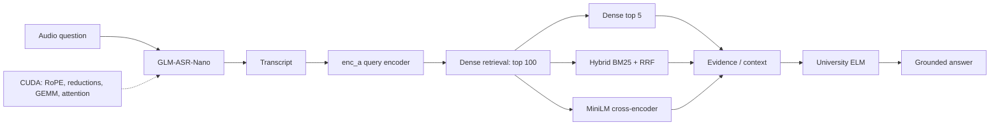

# Machine Learning Systems — CUDA ASR & RAG

**University of Edinburgh · INFR11269 · Autumn 2026**

Implementation and experimental evaluation of an audio-to-answer system combining custom **CUDA automatic speech recognition (ASR)** with **retrieval-augmented generation (RAG)**. This `MLS-Dwayne` branch preserves my CUDA work, RAG reranking implementations, evaluation code, and selected reproducibility results alongside the course-provided framework.

[CUDA ASR](hw1-asr/) · [RAG pipeline](rag/) · [RAG extensions](rag/extensions/) · [Verified experiment results](rag/results/) · [Official coursework repository](https://github.com/ed-aisys/edin-mls-26-autumn)

> **Status — 9 November 2026:** All four CUDA tasks, retrieval and reranking experiments, paired answer-quality analyses, and the final **same-node RTX 2080 Ti benchmark** are complete. The clean ASR test suite passed **33/33** cases. The remaining coursework work is interpretation, teammate discussion, and the joint six-page report—not further planned experiments.

## System architecture



The supplied RAG corpus contains approximately **24,000 records**, with **350 Practice** and **125 Development** audio queries. We use cached transcripts and common dense top-100 candidate lists to compare downstream reranking methods fairly. The University ELM service generates answers from the selected evidence.

## Project completion

| Component | Status | Verified evidence |
|---|---|---|
| Task 1 — RoPE | Complete | 4/4 tests; thread-size and precision investigations |
| Task 2 — Reductions | Complete | 11/11 tests; shuffle/atomic and Racecheck experiments |
| Task 3 — Tiled GEMM | Complete | 10/10 tests; tiling, coalescing, padding, fused GELU |
| Task 4 — Streaming attention | Complete | 8/8 tests; GQA, masking, online softmax, warp/padding sweep |
| Clean full-ASR regression | Complete | **33/33 tests PASS** on RTX 2080 Ti |
| RAG setup and reference baseline | Complete | Audio-to-answer smoke tests; full Practice/Dev retrieval |
| Hybrid BM25 + RRF reranking | Complete | Practice-tuned `alpha=0.95`; Dev 125 retrieval and judged answers |
| MiniLM neural cross-encoder | Complete | Dense top 100 → 5; Dev 125 retrieval and judged answers |
| Paired answer-quality analysis | Complete | **123 common judged queries**, judge sensitivity and uncertainty |
| Matched-node systems benchmark | Complete | **369 timed calls per method**, zero ranking mismatches |
| Joint coursework report | To prepare | Six-page report and course/AI-use compliance checks |

## CUDA ASR: correctness and performance

The four CUDA kernels use the following retained configurations:

| Kernel | Technique | Configuration |
|---|---|---|
| RoPE | In-place query/key rotary embedding | 256 threads/block, standard math |
| Reductions | Warp shuffles, block reductions, stable softmax | 256 threads/block |
| GEMM | Shared-memory tiling, padded weights, fused bias/GELU | `TILE=32` |
| Attention | Streaming K/V tiles and online softmax | 16 warps/block, padded key rows |

Following a clean rebuild, all **33 standalone tests passed**. Both backends produced the expected transcription for the supplied coursework audio clip.

| Same-node profiled ASR measurement | All PyTorch | All custom CUDA |
|---|---:|---:|
| Mean transcription latency | **1,078.8 ms** | **2,719.3 ms** |
| Reported peak GPU memory | 8.88 GiB | 8.56 GiB |
| Supplied transcription check | PASS | PASS |

The custom implementation is **2.52× slower end-to-end** in this comparison, chiefly because the instructional tiled GEMM is much slower than the tuned library path. It uses **0.32 GiB less reported peak GPU memory**. These are valid *negative performance findings*; numerical correctness and memory savings do not imply an end-to-end speedup. The transcription check covers one supplied clip, not general ASR recognition accuracy.

## RAG investigation: retrieval relevance versus system cost

We evaluated three fixed methods after collecting dense top-100 candidates:

1. **Dense baseline:** retain the original dense top-5. Teammate experiments also examined different context depths (`k=2/5/10/20`) and a separately generated top-5 baseline (`k5b`).
2. **Hybrid lexical reranker:** compute BM25 over the existing dense candidates and combine BM25 and dense rankings using **weighted reciprocal-rank fusion (RRF)**. The Practice-selected weight was **`alpha=0.95`** (dense weight; BM25 weight 0.05).
3. **Neural reranker:** score each query/document pair with the pretrained `cross-encoder/ms-marco-MiniLM-L6-v2` checkpoint, then retain top-5. The fixed configuration used batch size 16, max length 512, and checkpoint revision `233902d25c440f23af6f7d6e94d2946bac0bee0a`.

### Retrieval quality — complete Development split (125 queries)

Higher is better. These metrics are computed against the supplied relevance judgments.

| Method | Recall@5 | MRR@10 | NDCG@10 |
|---|---:|---:|---:|
| Dense top-5 baseline | 0.379497 | **0.459708** | **0.398342** |
| Hybrid, `alpha=0.95` | **0.380069** | 0.457517 | 0.396312 |
| MiniLM cross-encoder | 0.332570 | 0.400397 | 0.340290 |

Hybrid produced almost unchanged aggregate retrieval relevance. MiniLM **reduced** all three aggregate relevance metrics in this evaluation; a more sophisticated reranker did not guarantee better relevance.

### Judged answer quality — 123 common Development queries

The evaluator scores correctness, grounding, and completeness (each 0–4), divided by 12 to obtain a score in [0, 1]. Only the **123 queries with comparable saved judgments across methods** are used here.

| Method | Mean normalised score | Paired difference vs `k5` |
|---|---:|---:|
| Dense `k5` baseline | 0.327236 | — |
| Independent-generation `k5b` | 0.323171 | −0.004065 |
| Hybrid | **0.341463** | +0.014228 |
| MiniLM | 0.324526 | −0.002710 |

Approximate 95% paired intervals for **Hybrid − k5** ([−0.028050, +0.056506]) and **MiniLM − k5** ([−0.056440, +0.051020]) both include zero: **neither demonstrates a clear overall answer-quality gain** under this evaluation.

**Important qualification:** Hybrid deliberately reused previously generated answers and judgments for **56 identical `k5b` contexts** among the 123 common queries; four more came from an earlier Hybrid smoke run. Differences in generation/judge draws therefore prevent attributing the small aggregate score difference solely to the reranker. Our paired bootstrap and changed-context sensitivity analyses preserve these limitations. In the post-hoc subgroup of **23 queries where MiniLM reduced labelled Recall@5**, answer scores also fell; this is a descriptive association, not proof of causality.

### Final matched-hardware benchmark — 8 November 2026

The final job (`3705581`) **completed successfully** on `damnii07`, with **NVIDIA GeForce RTX 2080 Ti**. Both methods received the same 123 transcripts and dense top-100 candidate sets. After five warm-up queries, we timed **three passes of 123 reranking calls per method** (369 timings each), alternating execution order. Both reproduced saved top-5 rankings exactly.

| Reranking-only metric | Hybrid on CPU | MiniLM on RTX 2080 Ti |
|---|---:|---:|
| Mean latency | **22.09 ms** | **280.52 ms** |
| Median latency | 22.35 ms | 281.84 ms |
| P95 latency | 27.83 ms | 327.34 ms |
| Initial index build / model load | 3.52 s | 18.67 s |
| Timed calls | 369 | 369 |
| Top-5 ranking mismatches | **0** | **0** |

**Observed mean latency ratio: 12.70×** — MiniLM reranking took about 12.7 times as long as Hybrid reranking *for these deployed methods on the same node*. This does not compare CPU and GPU hardware efficiency. Times **exclude** embedding, dense retrieval, generation, judging, and initial setup. The 369 timings are repetitions on 123 distinct queries, **not 369 independent queries**.

The benchmark recorded **223.03 MiB peak PyTorch-allocated GPU memory** during its GPU work; this is not total GPU process memory.

**Combined finding:** In our fixed configuration, the lightweight Hybrid reranker incurred much lower measured reranking latency while keeping aggregate retrieval quality similar to dense. MiniLM incurred substantially greater reranking cost, reduced aggregate labelled retrieval quality, and showed no established overall judged-answer improvement. Results apply to these methods, data, hardware, and saved judgments—not every lexical or neural reranker.

## Reproducibility and saved evidence

The following code and selected experiment records are versioned on `MLS-Dwayne`:

| Artifact | Purpose |
|---|---|
| [`rag/extensions/hybrid_reranker.py`](rag/extensions/hybrid_reranker.py) | Corpus BM25 statistics and weighted RRF ranking |
| [`rag/extensions/cross_encoder_reranker.py`](rag/extensions/cross_encoder_reranker.py) | MiniLM reranking implementation |
| [`rag/extensions/analyse_reranking_unified.py`](rag/extensions/analyse_reranking_unified.py) | 123-query paired analysis using saved judgments |
| [`rag/results/reranking_unified_dev123.json`](rag/results/reranking_unified_dev123.json) | Saved comparative quality statistics |
| [`rag/extensions/benchmark_reranking_matched.py`](rag/extensions/benchmark_reranking_matched.py) | Validated matched-node benchmark |
| [`rag/extensions/run_matched_damnii.sbatch`](rag/extensions/run_matched_damnii.sbatch) | Slurm launch configuration for RTX 2080 Ti |
| [`rag/results/reranking_matched_damnii_3705581.json`](rag/results/reranking_matched_damnii_3705581.json) | Full matched-node measurements, hardware and consistency checks |

The benchmark script supports a **read-only input check** when the course dataset, saved dense rankings and cached MiniLM checkpoint are available:

```bash
python rag/extensions/benchmark_reranking_matched.py --validate-only
```

Full benchmarking additionally requires an authorised Slurm allocation with an RTX 2080 Ti. It explicitly checks that GPU model; it will not silently switch hardware. The saved result JSON contains the complete matched experiment, so re-running it is not necessary to inspect the findings.

The unified judge analysis additionally relies on our teammate's pinned saved results (commit `f54c766616cf247306613d01a565e7c882a72413`). **Selected scripts and results are published**, but the repository is **not** a standalone redistribution of the University corpus, ASR weights, MiniLM weights, transcript caches or private ELM credentials. Follow University access and checkpoint-use rules when reproducing the study.

## Repository layout

```text
.
├── cuda-tutorial/       # Course CUDA programming exercises
├── hw1-asr/             # Four custom CUDA tasks, tests and ASR runner
├── rag/
│   ├── src/            # ASR adapter, encoder, retriever, context, generator
│   ├── scripts/        # Pipeline, setup and evaluation utilities
│   ├── extensions/     # Hybrid and MiniLM implementations and analyses
│   └── results/        # Selected published retrieval and benchmark outputs
└── report/              # Course report resources, where present
```

For installation and model-data requirements, use the [official ASR guide](hw1-asr/README.md) and [RAG setup guide](rag/README.md). The ASR and RAG Python environments are separate. Local ELM credentials belong in `rag/.env` and **must never be committed**.

## Attribution and research limitations

This project is based on the **INFR11269 Machine Learning Systems** Autumn 2026 coursework framework by the University of Edinburgh: [`ed-aisys/edin-mls-26-autumn`](https://github.com/ed-aisys/edin-mls-26-autumn). The underlying starter framework, corpus, official tests, and guides are course-provided. My contributions include the four completed CUDA task implementations and the Hybrid/MiniLM systems investigation; the retrieval-depth sweeps and baseline generation results used for comparison were contributed by my teammate.

A pretrained third-party MiniLM checkpoint was used for research comparison, **not trained from scratch**. Its permissibility and required acknowledgement in the final coursework report remain subject to checking the applicable course rules. Saved evaluator scores, qrels coverage, answer reuse, independent ELM calls and limited hardware repeats constrain causal interpretation. The final six-page report and any required AI-use disclosure are separate coursework deliverables.

*README last updated: 9 November 2026. All numbers above describe completed, recorded experiments.*
